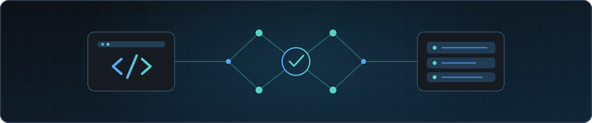

<!--
  GitHub profile README · V2
  Design: responsive by default, lightweight, accessible, no third-party stat widgets.
  Personal portrait: this uses the current GitHub avatar; replace it with a dedicated
  photo in assets/profile.jpg once a preferred photo is provided.
-->

  

# Domenico Di Tommaso

**Computer Engineering Student · Software Engineering & AI Product Building**

I build software products with a focus on **clean architecture, practical execution, and verifiable outcomes**.  
My interests span backend development, data-driven systems, AI-enabled workflows, and financial technology.

[Portfolio](https://domenicoditommaso.vercel.app/) · [LinkedIn](https://www.linkedin.com/in/domenico-di-tommaso) · [GitHub](https://github.com/domedtms)

---

## Selected work

### [Civitas — Java MVC Web Application](https://github.com/domedtms/civitas-tiw)

**Java 17 · Servlet · JSP · JDBC · MySQL · Maven · GitHub Actions**

A web application for governing fictional micro-nations, developed for the **Tecnologie Informatiche per il Web** course at **Politecnico di Milano**.

- Designed a layered application with controllers, services, data-access objects, and relational models.
- Implemented authentication, role-based actions, law proposals, voting workflows, and decision history.
- Built JSON/AJAX dashboard features and automated in-app newspaper generation.
- Documented architecture, HTTP flows, database design, test plans, and a feature-branch / pull-request workflow.
- Added a GitHub Actions workflow that builds the Java WAR with Maven.

**Academic result: 30/30 cum laude (30L)** in the associated university exam.

[Explore the source code and architecture →](https://github.com/domedtms/civitas-tiw)

### PLUS — AI Financial Technology Platform

**AI-assisted analysis · Financial data workflows · Software architecture · Tokenization research & development**

An evolving project exploring how financial information can become more **structured, interpretable, and verifiable**.

My work covers technical planning, product thinking, software architecture, and the development of financial-data and AI-oriented workflows. Blockchain, attestation, and tokenization are part of the broader development roadmap; their implementation status varies by component.

*The core repositories are private. This profile intentionally distinguishes implemented work from planned capabilities.*

### [Personal Portfolio — React Web App](https://github.com/domedtms/portfolio)

**React · JavaScript · Vite · Tailwind CSS · Vercel**

A personal website built to present software projects, technical experience, and the decisions behind my work.

[View live website →](https://domenicoditommaso.vercel.app/)

---

## How I work

I care about **understanding the problem before choosing the technology**, separating responsibilities in code, documenting decisions, and iterating through working versions.

**Design → Build → Validate → Improve**

Areas I work with:

- **Languages:** Java, Python, JavaScript, SQL, C++
- **Backend & data:** Java Servlet/JDBC, FastAPI, REST APIs, relational databases
- **Frontend:** React, HTML, CSS, Tailwind CSS
- **Workflow:** Git, GitHub pull requests, Maven, Docker, GitHub Actions
- **Exploring:** AI-powered product systems, cloud infrastructure, financial technology

These are technologies and areas of experience or active learning—not a claim of equal proficiency in every tool.

## Currently exploring

- Building reliable and maintainable software systems.
- Turning AI-assisted workflows into usable products.
- Connecting software engineering, financial data, and product design.

## Let's connect

I enjoy talking about engineering decisions, new ideas, and products being built in the real world.

[**Portfolio**](https://domenicoditommaso.vercel.app/) · [**LinkedIn**](https://www.linkedin.com/in/domenico-di-tommaso)

<!--
  PHOTO SLOT (optional):
  Add assets/profile.jpg after choosing a high-resolution personal photo.
  Then replace the external GitHub avatar above with:
  
  Keep the portrait simple and compressed for mobile readers.
-->
